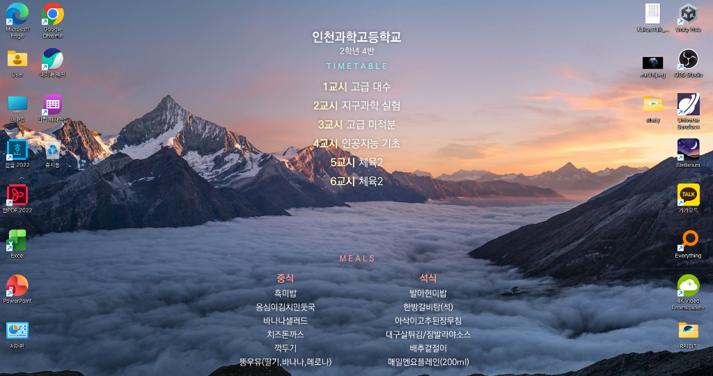

# School Wallpaper Sync

A Windows desktop assistant that automatically syncs and displays your daily class timetable, school meals, and upcoming school-schedule D-Days directly on an aesthetic desktop wallpaper.



---

## ✨ Features

- **Today / Tomorrow**: Fetches the selected day's timetable and meals via the official [NEIS Open API](https://open.neis.go.kr). The wallpaper always identifies its data date. D-Day counts remain based on the actual current day.
- **Manual timetable corrections**: Override a subject for a specific date and period, or add a period missing from NEIS. The original API cache is preserved; overrides are applied when rendering. If every remote query fails and no matching cache exists, a manual timetable for the selected date can still be applied; data status remains unavailable and Apply reports the fallback.
- **Meal details**: Read the school's original dish text with allergy numbers, calories, nutrition information and ingredient origins when supplied by NEIS.
- **D-Day Countdown**: Shows the nearest upcoming school-schedule events (holidays, exams, ceremonies, etc.), right-aligned on one line. Pulls automatically from NEIS, and you can add your own entries (e.g. exam dates NEIS doesn't publish) with an optional custom color per entry — manual entries always get priority over automatic ones.
- **Aesthetic Backgrounds**: Automatically rotates daily through 8 built-in premium wallpapers, or pin one you like, or use your own photo.
- **Minimalist Layout**: Clean typography directly on the wallpaper, no cards or boxes.
- **Fully Automatic Updates**: The first time you apply, it registers itself in Windows (startup + a repeating scheduled task) so your timetable/meals/D-Day keep refreshing on their own — nothing to set up by hand, and no need to keep any app open.
- **Theme editor**: Three built-in designs (수업용, 집중용, 배경 중심), named personal themes, duplication, rename/delete, and JSON import/export. Built-ins remain protected; duplicate them to create an editable personal theme.
- **Preview tools**: In-window preview, zoom/fit, a grid overlay, comparison with the saved design, and section-position alignment. Grid/comparison helpers are excluded from wallpaper output and exported PNGs.
- **Apply / Cancel**: Apply explicitly saves the chosen configuration and updates the wallpaper. Cancel restores the last successfully applied settings. Theme saves contain visual settings only; school, class, API key, and manual D-Day entries remain separate.
- **Editing and backups**: Undo/redo for up to 60 editor states, unapplied-change indicator, settings backup/restore without API keys, and PNG export. Restoring a backup loads an editable draft; it does not apply the desktop wallpaper.
- **Data status**: Refresh school data explicitly and distinguish fresh/empty/cached/unavailable results. The displayed cache recording time is not a claim about the last successful remote query.

---

## 🚀 How to Get Started

1. Download and run `SchoolWallpaperSettings.exe` (from a [Release](../../releases/latest) or built yourself, see below).
2. On the **기본 설정** tab: type your school name, hit 검색, pick your school from the results, then enter your grade and class.
3. Pick a background: automatic daily rotation, a fixed one of the 8 built-ins, or your own photo file.
4. Click **저장 및 지금 적용**. Your wallpaper updates immediately, and from then on it keeps itself up to date automatically — you don't need to do anything else.
5. Choose a built-in theme or adjust colors, position, font size, and shadows. Changes appear only in the **적용 전 미리보기** panel. Click **현재 디자인 저장** to keep a named design, **저장 및 지금 적용** to activate it, or **변경 취소** to restore the last applied state.
6. Saved designs live in `themes.json` beside the EXE. Use the **테마** menu to duplicate, rename, delete or exchange designs. Duplicate names are rejected. Existing `config.json` settings are retained; reading the library does not create a file.
7. Choose **오늘 / 내일**, use **데이터 새로고침** (F5), and open **급식 상세** or **수동 시간표** as needed. Changing the selected date or a manual subject affects the draft until you apply it. Changing school/class clears previous manual timetable corrections.
8. Use the **파일** menu to back up the current editing settings, load a backup, or export the current design as PNG. Backup files include school information, visual settings, selected day and manual events/timetable corrections, but exclude API keys, original photo files and the theme library. Keep photos and `themes.json` separately.

The preview uses cached or explicitly refreshed data for the selected school and date. If no school is configured, it shows clearly labeled sample data. If a school is configured but has no matching cache, use F5 or Apply to fetch data. Refreshing an unapplied tomorrow draft does not overwrite the active today's cache. Opening the editor does not apply a wallpaper or register scheduled tasks; existing background tasks continue using the saved settings.

Theme exports reference custom photos by path and do not bundle the image. On another computer, select the photo again if that path is unavailable. Automatic theme switching, cloud synchronization and Android packaging are not included.

The editor retains the original v1.4 buttons, native menus and three settings tabs. Themes and daily tools sit below the settings tabs; zoom, grid and saved-design comparison sit below the preview. Native menu text uses an 11-point font, with shorter labels and status messages.

The **글자 색상 설정** tab includes six color palettes with swatches, grouped changes for all text/body/headings and accents, and a color-only reset. These edits preserve layout, photos and school settings, update the preview and support undo/redo. The tab scrolls on smaller windows.

The **기본 설정** tab provides previous/next class and background-photo controls, plus separate restoration of the saved class or background. Switching class clears manual timetable corrections in the draft; undo restores them. Photo navigation cycles through the built-in photos and switches to fixed-photo mode without discarding a custom photo path.

Each section in **배치 및 효과 설정** has position shortcuts, bounded font-size steps and three effect presets. Effect presets honor **테두리·그림자 함께 적용**; position and size changes affect only the selected section. Every shortcut supports undo/redo and requires Apply to change the desktop. All color panels share the same two-column alignment and spacing, while existing button shapes and sizes are retained. Desktop shortcut widgets live in `editor_shortcuts.py`; portable settings and history remain in `core/`.

Optional quick controls and color tools are collapsed initially; expand their headings when needed. The app window is titled **학교 바탕화면** and uses the bundled timetable-and-wallpaper icon.

### Keyboard shortcuts

| Shortcut | Action |
| --- | --- |
| Ctrl+Z / Ctrl+Y | Undo / redo |
| Ctrl+S | Save the current design as a named theme |
| Ctrl+Enter | Save settings and apply the wallpaper |
| Ctrl+O | Load a settings backup into the editor |
| Ctrl+0 | Fit the preview to its panel |
| F5 | Refresh school data for the selected date |
| F1 | Open usage instructions |

Download the Windows executable, source archive, SHA-256 checksum and validation report from the [v1.5.0 release](https://github.com/dohye0508/school-wallpaper-sync/releases/tag/v1.5.0).

---

## 🛠️ Building from Source

```bash
pip install -r requirements-dev.txt
build.bat
```

This produces `SchoolWallpaperSettings.exe` in the project root. `main.py` is the engine (also runnable standalone with `--background` for silent updates, or `--reset` to clear saved settings); `settings_gui.py` is the GUI; `app.py` is the entry point that picks between them.

## Development and regression checks

```bash
python -m pip install -r requirements.txt
python -m unittest discover -s tests -v
python -m compileall -q main.py app.py settings_gui.py editor_tools.py core adapters hooks
```

See [ARCHITECTURE.md](ARCHITECTURE.md) for synchronization guarantees and the Android boundary.
Rebuild the executable after changing sources; an existing EXE does not contain these fixes.

Windowless background runs record results in `sync.log` (rotated) and `last_run.json`
beside the executable. A missing school configuration or failed Task Scheduler registration
now returns a nonzero exit code. The two Windows tasks use an interactive user token,
run on battery power, and retain their existing start time when the configuration is unchanged.
The `hooks/` directory preserves extra SSL policy data when building with a managed
Python distribution; keep `--additional-hooks-dir hooks` when invoking PyInstaller directly.

---

## 🎨 License

Feel free to use and modify for personal purposes. Keep your study and meals organized beautifully!
